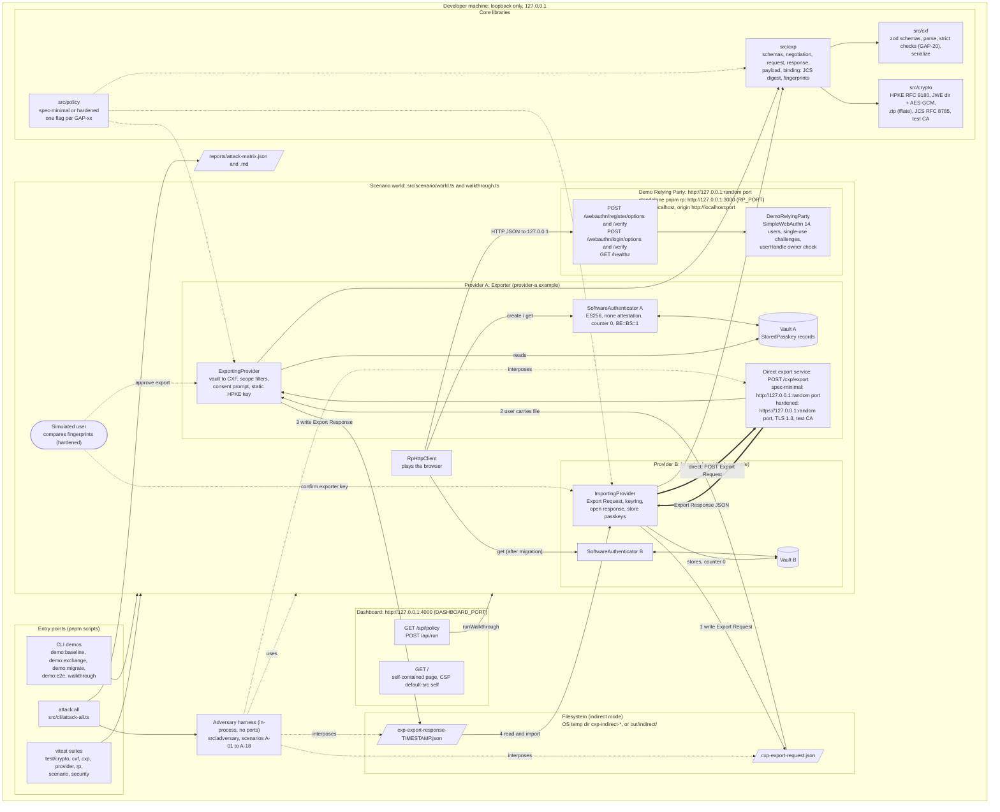
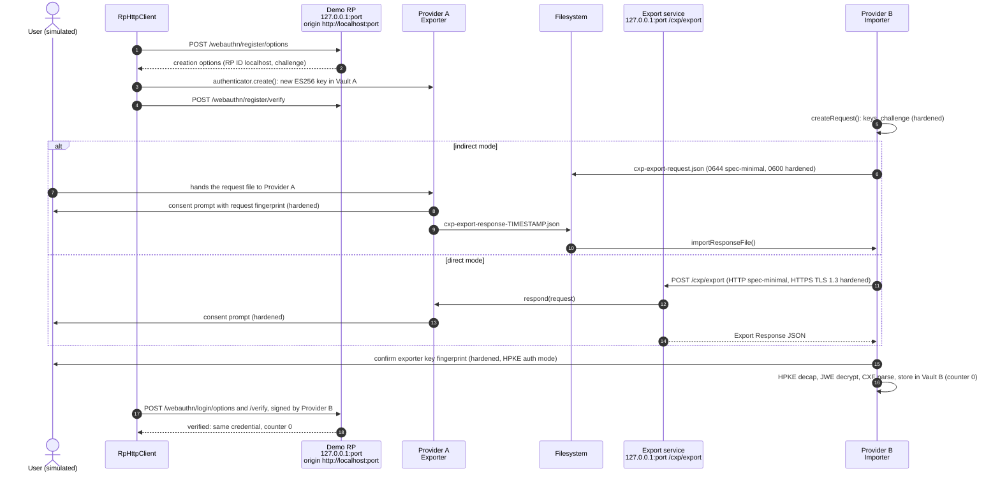

# Architecture — CXP Migration PoC

Every network component binds to the IPv4 loopback address **127.0.0.1**; nothing listens on another interface and nothing talks to the internet (README §9 rule 6). Ports are chosen by the OS (`listen(0)`) unless a standalone script fixes them.

## 1. Components and addresses

## 2. Migration sequence (one run)

## 3. Addresses and ports

| Component | Bind address | Port | Protocol | Started by |
|---|---|---|---|---|
| Demo RP (tests, demos, dashboard runs) | 127.0.0.1 | random (OS-assigned) | HTTP | `startDemoRp()` via `createWorld()` |
| Demo RP (standalone) | 127.0.0.1 | 3000 (`RP_PORT`) | HTTP | `pnpm rp` |
| WebAuthn origin / RP ID | `http://localhost:<port>` / `localhost` | same as RP | — | reported in clientDataJSON; `localhost` is a secure context |
| Direct export service (spec-minimal) | 127.0.0.1 | random | HTTP | `startExporterService()` |
| Direct export service (hardened) | 127.0.0.1 | random | HTTPS, TLS 1.3, per-run test CA (SAN 127.0.0.1, localhost) | `startExporterService({ tls })` |
| Dashboard | 127.0.0.1 | 4000 (`DASHBOARD_PORT`) | HTTP | `pnpm dashboard` |
| Indirect-mode files | — | — | filesystem | OS temp dir `cxp-indirect-*`, or `out/indirect/` (`pnpm demo:migrate`) |
| Adversary harness | — (in-process) | none | — | `pnpm attack:all`, `test/security/*` |
